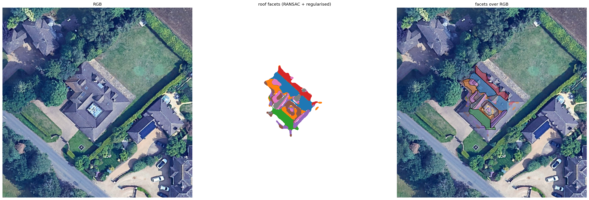
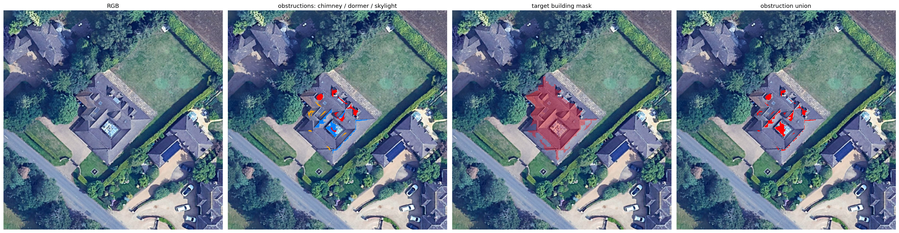
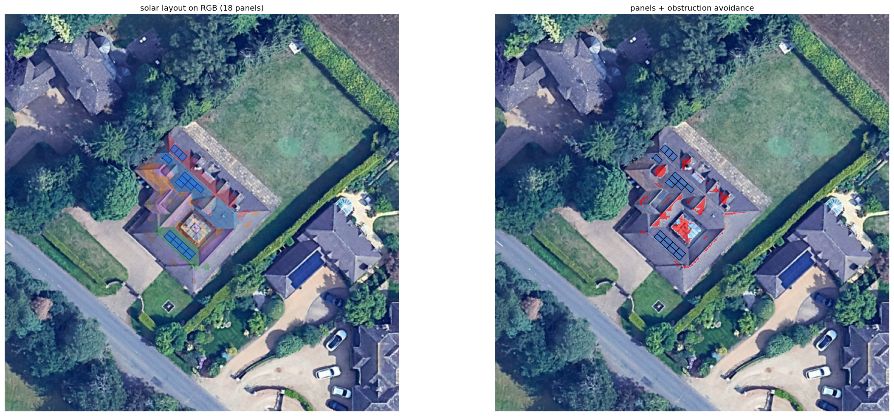
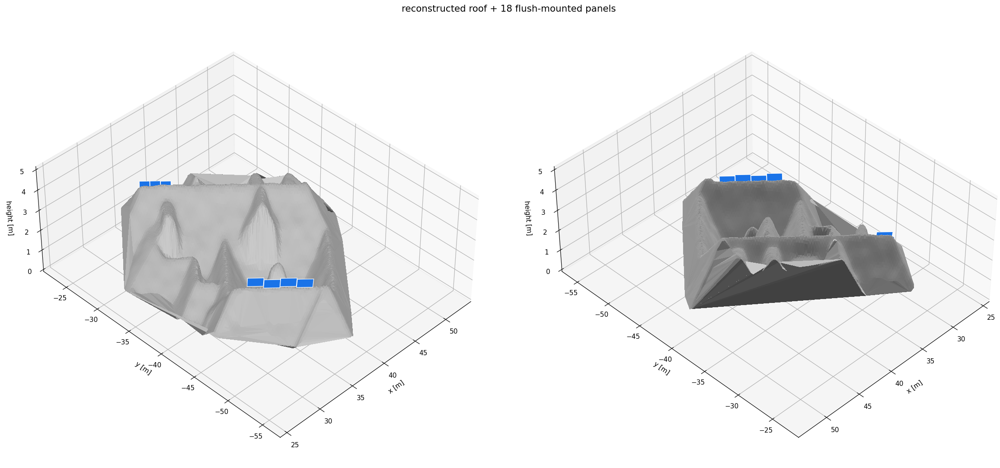

# roof-solar-optimized

**3D roof reconstruction and flush-mounted solar-panel placement** from a digital
surface model (DSM) plus a co-registered RGB ortho image.

Given a 10 cm-resolution DSM and ortho of a residential site, the pipeline

1. detects the target building,
2. reconstructs its roof as a set of regularised planar facets with a
   centimetre-accurate fit,
3. finds rooftop obstructions (chimneys, dormers, skylights and glass roofs),
4. exports a 3D roof mesh, and
5. packs standard PV modules flush onto the usable roof faces, avoiding ridges,
   edges and obstructions.

Everything is reproducible from one command and every figure in this README is
generated by the pipeline.

---

## Results (target house)

| Quantity | Value |
|---|---|
| Panels placed | **18** |
| Installed capacity | **7.74 kWp** |
| Module | 1.72 × 1.13 m, 430 W, flush-mounted |
| Module area | 34.98 m² |
| Roof facets used | 4 (three carrying panels) |
| Facet-fit RMS | 0.04–0.08 m |
| Obstructions found | 7 chimneys, 7 dormers, 9 skylights/glass |

| Reconstructed roof facets | Obstructions |
|---|---|
|  |  |

| Panel layout (2D) | Roof + panels (3D) |
|---|---|
|  |  |

> An interactive version of the 3D result is written to
> `outputs/roof_and_panels.html` (open it in a browser).

**Demo video:** _see `DEMO_SCRIPT.md` for the walkthrough script; link to be added._

---

## Repository layout

```
roof-solar-optimized/
├── configs/default.yaml          # all thresholds / parameters
├── data/                         # input GeoTIFFs (rgb, dsm_full, dsm_clipped)
├── src/roofsolar/
│   ├── io.py                     # raster loading, ROI mapping, nodata inpainting
│   ├── coords.py                 # pixel <-> local metric (x=east, y=north) frame
│   ├── terrain.py                # slope / aspect (Horn), plane <-> normal
│   ├── preprocess.py             # denoise, ground estimation, roughness, vegetation
│   ├── buildings.py              # building detection + target selection
│   ├── segmentation.py           # sequential-RANSAC planar facet extraction
│   ├── obstructions.py           # chimneys / dormers / skylights
│   ├── reconstruction.py         # roof mesh + OBJ export
│   ├── panels.py                 # flush-mount panel packing per facet
│   ├── solar.py                  # sun vectors + annual irradiance factor
│   ├── viz.py                    # all figures
│   ├── pipeline.py               # orchestration + GeoJSON/metrics/HTML exports
│   └── __main__.py               # CLI entry point
├── scripts/run.sh                # run with the current interpreter
├── scripts/run_demo.sh           # create venv, install deps, run
├── outputs/                      # generated figures and data
└── tests/                        # geometry, packing and inpainting tests
```

---

## Setup

Requirements: **Python ≥ 3.9** and a C-free scientific stack (all dependencies
ship wheels).

```bash
git clone git@github.com:obtype/roof-solar-optimized.git
cd roof-solar-optimized

python3 -m venv .venv
source .venv/bin/activate
pip install -r requirements.txt        # or: pip install -e ".[dev]"
```

Dependencies: `numpy`, `scipy`, `rasterio`, `opencv-python-headless`, `shapely`,
`matplotlib`, `plotly`, `PyYAML` (and `pytest` for the tests).

## Run

```bash
PYTHONPATH=src python3 -m roofsolar --config configs/default.yaml
# or, after `pip install -e .`:
roofsolar --config configs/default.yaml
# or:
bash scripts/run.sh
```

One-shot setup + run:

```bash
bash scripts/run_demo.sh
```

The run takes ~15 s on a laptop CPU and writes everything into `outputs/`.

### Outputs

| File | Contents |
|---|---|
| `01_overview.png` | RGB, DSM, height-above-ground, hillshade, slope, aspect |
| `02_roof_facets.png` | facet labels over the ortho |
| `03_obstructions.png` | chimney / dormer / skylight masks and their union |
| `04_3d_roof.png` | reconstructed roof surface in 3D |
| `05_panel_layout_2d.png` | panel layout over the ortho with obstruction avoidance |
| `06_panel_layout_3d.png` | roof + panels in 3D |
| `07_missing_data.png` | `dsm_clipped` nodata and two inpainting strategies |
| `roof_and_panels.html` | interactive 3D scene (plotly) |
| `roof_mesh.obj`, `panels.obj` | roof mesh and panel meshes |
| `facets.geojson`, `panels.geojson` | georeferenced facets and panels |
| `metrics.json` | summary metrics (capacity, facet stats, obstructions) |

---

## Method

### 1. Data model and preprocessing

The **full DSM** is the processing grid (north-up, 0.1 m/px, EPSG:32630). A local
right-handed metric frame is used throughout: **x → east, y → north**
(`coords.py`), so slope/aspect, azimuth and sun vectors share one convention.
The DSM is lightly denoised (Gaussian σ = 1 px).

**Ground** is estimated on a coarse grid by a moving low percentile (robust to
buildings and trees); **height-above-ground** is DSM − ground. A **local
roughness** field (local standard deviation of the residual) separates smooth
roof planes from rough vegetation, and an HSV **vegetation mask** removes trees.

The `dsm_clipped` raster is used only to demonstrate missing-data handling: its
nodata fraction is quantified and two fills are compared — sampling a
co-registered reference DSM, and pure iterative neighbour inpainting
(`io.fill_nodata`, see `07_missing_data.png`).

### 2. Building detection and target selection

A building mask is `height-above-ground ∈ [1.7, 8.5] m` **and** local roughness
below a threshold **and** not vegetation, cleaned morphologically. Connected
components are filtered by area and planar fraction. The **target house** is the
largest surviving component overlapping the `dsm_clipped` parcel footprint
(`buildings.py`) — so the pipeline is generic, and just targets the relevant
parcel on this site.

### 3. Roof reconstruction — regularised planar facets

Roofs are piecewise planar, so the reconstruction is a set of planes
(`segmentation.py`):

1. **Sequential RANSAC** fits `z = a·x + b·y + c` to DSM samples of the building;
   each round removes the plane with the most inliers, so a hipped roof
   decomposes into its slope facets.
2. Every pixel is assigned to its best plane; a median filter removes
   salt-and-pepper mislabelling and small components are dropped.
3. Each facet is **re-fitted by least squares** from its assigned pixels.
4. Adjacent facets with near-identical normals **and** planes are merged.
5. Facet **azimuths are snapped** to a small set of dominant building directions,
   removing angular noise from the smoothed DSM while keeping the fitted pitch.

Each `Facet` carries its plane, azimuth, slope, area, centroid and RMS residual.
The fit quality (0.04–0.08 m) is the quantitative reconstruction-accuracy
measure. A roof mesh is triangulated from the assignment and exported as
`roof_mesh.obj`.

### 4. Obstruction detection

Two complementary cues (`obstructions.py`), restricted to the target building:

* **Chimneys / dormers** — positive residuals of the measured DSM against the
  regularised facet planes. Compact, tall, small-footprint blobs are chimneys;
  broader raised blobs are dormers.
* **Skylights / roof windows / glass** — bright, low-saturation (glass-like)
  pixels in the ortho, kept only where they lie flush on a plane.

### 5. Panel placement (flush-mounted)

Each facet is an independent planar surface and placement happens in its own
**in-plane metric coordinate system** `(u, v)` (`panels.py`):

1. The facet footprint and any obstructions inside it are rasterised in `(u, v)`
   and vectorised. Non-planar interior holes are treated as obstacles.
2. The **usable polygon** = footprint shrunk by an edge/ridge/eave **setback**,
   minus obstructions grown by a **clearance** buffer.
3. Standard modules are packed on a rectilinear lattice aligned with the facet
   strike; **both orientations** (landscape/portrait) are tried and the denser
   one wins. A panel is accepted only if its rectangle lies entirely inside the
   usable polygon.

Because everything is done in true in-plane metres, a module can never overlap
an obstruction, cross a ridge or exceed the roof edge. Panels are flush, i.e.
their plane equals the facet plane.

### 6. Solar scoring

A clear-sky beam model integrates `max(0, n·s)` over representative days and
daylight hours (`solar.py`) to score each facet and to report a relative annual
irradiance factor per panel. On this site the **north-east** (az 42°) face scores
highest.

---

## Assumptions

* **Flush mounting** — panel tilt equals roof pitch; arrays follow the roof plane.
* **No inter-row shading** — valid for flush arrays; combined with the slope
  limits (10–60°) this is the standard residential case.
* **Standard module** — 1.72 × 1.13 m, 430 W, configurable in `configs/default.yaml`.
* **Rectilinear arrays** — panels are laid on a lattice aligned with each facet's
  strike; this is how real installations are mounted.
* **Rigid, single-material roof** — planarity of a facet is assumed.
* The DSM and ortho are co-registered and georeferenced (they are).

## Limitations

* **Walls and vertical faces are not reconstructed** — only the roof surface is.
* **One hip is missed** — the south-east slope (~133°) was not extracted as its
  own facet on this site; low-slope facets (3–7°) are found but rejected for
  panels by the pitch filter.
* **Occlusion is ignored** — a simple clear-sky model without shading from trees
  or neighbouring buildings; the residual-based obstruction detector can also
  conflate a large raised region with a dormer.
* **Trees adjacent to the roof** can locally affect the ground estimate.
* Obstruction classes are heuristic (height + brightness), not a trained model.

## Incomplete / future work

* Shadow/occlusion modelling (horizon profile) for a true annual yield.
* Facet boundary regularisation so adjacent planes intersect exactly at ridges
  (currently planes are fit independently).
* Wall reconstruction / full building solid.
* A trained obstruction classifier and skylight/vent disambiguation.
* Automated azimuth-snapping to the *building* axes rather than a global cluster.

---

## Tests

```bash
pip install pytest
python3 -m pytest -q
```

* `test_terrain.py` — slope/aspect against a synthetic plane, plane↔normal round-trip.
* `test_coords.py` — pixel↔metric conversion and round-trip.
* `test_io.py` — nodata inpainting with a reference and by interpolation alone.
* `test_panels.py` — in-plane packing validity (non-overlapping, inside bounds)
  and end-to-end flush placement on a synthetic facet.

## Configuration

All thresholds live in `configs/default.yaml`, grouped by stage
(`preprocess`, `ground`, `buildings`, `segmentation`, `obstructions`, `panels`).
Examples: module size and power, panel setback/clearance, viable pitch range,
RANSAC inlier threshold, obstruction heights and glass brightness.

## License

MIT — see `LICENSE`.
